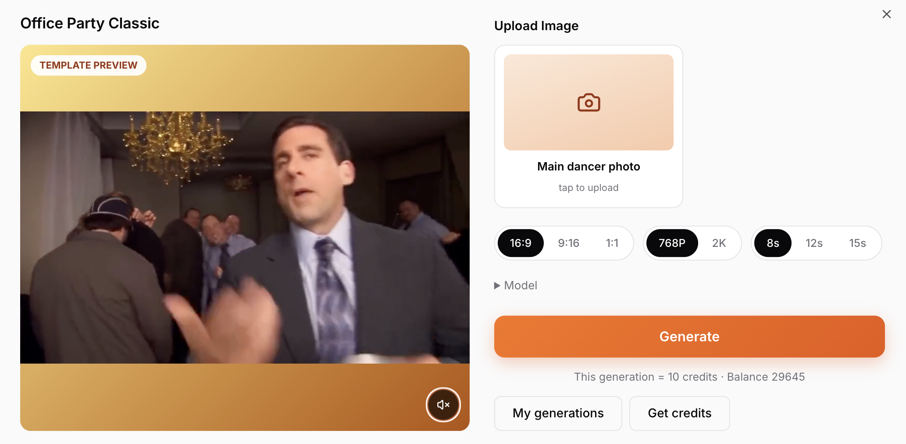

<div align="center">

# ViralReel — AI Viral Video Generator

**Turn one photo into the viral video format everyone is posting — Hotel Lobby, Burning Bridges and more.**

[](http://www.viralreel.app)
[](https://nextjs.org)
[](https://workers.cloudflare.com)

[English](README.md) | [简体中文](README.zh-CN.md)


</div>

**ViralReel** ([viralreel.app](http://www.viralreel.app)) is a production AI SaaS that recreates trending video formats (the COLORS-style *Hotel Lobby* stage, the *Burning Bridges* chandelier party, etc.) from user-uploaded photos — with credits-based billing, multi-model video generation, a bilingual SEO-optimized blog, and a full admin console. Deployed on Cloudflare Workers.

## Features

### 1. Viral Video Templates

Tuned variants of real trending formats. Each template ships with a pre-filled prompt, reference assets, and a preview:

| Office Party (Burning Bridges) | Party Lead | Pet & Owner |
|---|---|---|
|  |  |  |

### 2. One-Photo Generation

Upload a photo, pick aspect ratio / resolution / duration, and generate. The generator dialog shows the exact credit cost before you confirm, streams progress while the model renders, and keeps a full generation history.



### 3. Multi-Model Video Generation

- **MiniMax H3** — multimodal model supporting reference **audio** (≤ 15 s, up to 3 clips) to drive vocals and sound style, plus reference images
- **Grok Imagine** — media-relay image-to-video
- Pluggable **media-relay / task-relay** provider architecture, so new models are a config change, not a rewrite

### 4. Credits, Plans & Payments

- Three subscription plans (**Starter / Plus / Pro**, monthly & yearly) plus pay-as-you-go credit top-ups
- Per-video pricing defined per resolution × duration (480p–1080p, 8–15 s), editable from the admin console
- Payment provider abstraction with checkout, billing history and automatic refunds for failed/canceled generations

### 5. Bilingual Blog with SEO & GEO

- MDX-based blog (English + 简体中文), rich embedded media (images & video)
- Per-post Open Graph / Twitter cards, `BlogPosting` JSON-LD, sitemap & canonical URLs
- AI answer engines (GPTBot, PerplexityBot, ClaudeBot…) are explicitly allowed in `robots.ts`

### 6. Admin Console

Runtime configuration without redeploying: switch models and providers, edit pricing and credit costs, upload reference audio for MiniMax H3, manage posts and users.

### 7. Accounts & Auth

Google OAuth **and** Google One Tap, built on better-auth; per-user credit ledger and generation history.

### 8. Full i18n

Every page — landing, pricing, blog, dashboard, transactional emails — is available in English and Simplified Chinese with locale-aware metadata.

### 9. Deploy to Cloudflare in One Push

GitHub Actions builds the OpenNext worker and deploys to **Cloudflare Workers + D1** automatically on every push to `main`. `wrangler.toml` holds the worker config; the docker workflow is also included.

## Tech Stack

| Layer | Tech |
|---|---|
| Framework | Next.js 15 (App Router) · React · TypeScript |
| Styling | Tailwind CSS · shadcn/ui · magicui |
| i18n | next-intl (en / zh) |
| Database | Drizzle ORM · Cloudflare D1 / SQLite |
| Auth | better-auth (Google OAuth + One Tap) |
| Content | MDX · fumadocs |
| Payments | Stripe / Creem (provider-agnostic checkout) |
| Infra | Cloudflare Workers · GitHub Actions CI/CD |

## Getting Started

```bash
# 1. install dependencies
pnpm install

# 2. configure environment (see .env.example)
cp .env.example .env

# 3. run locally
npm run dev
```

Deployment targets Cloudflare Workers via OpenNext — worker config lives in `wrangler.toml`, and the CI/CD workflow is in `.github/workflows/`.

## Links

- 🌐 **Live site**: [http://www.viralreel.app](http://www.viralreel.app)
- 📝 Blog: [viralreel.app/blog](http://www.viralreel.app/blog)

## License

The source code is provided for reference only and may not be redistributed. See [LICENSE](./LICENSE) for details.
